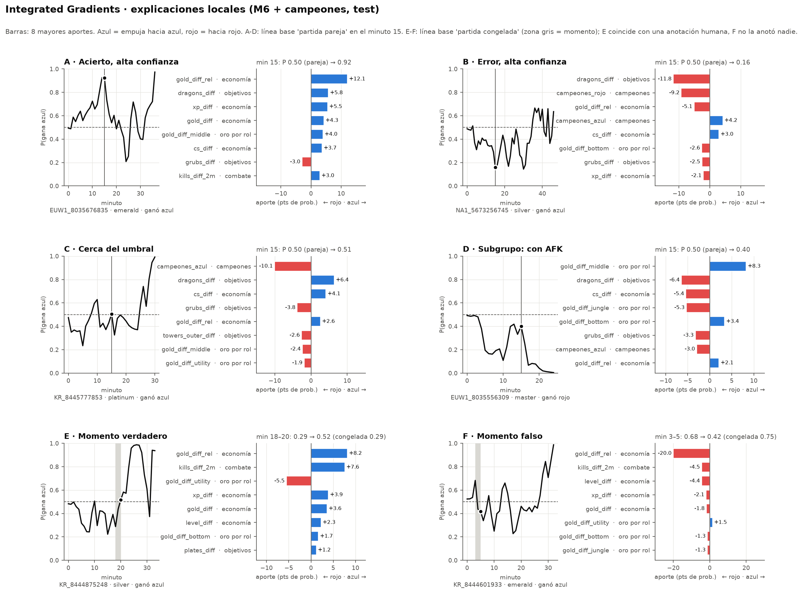
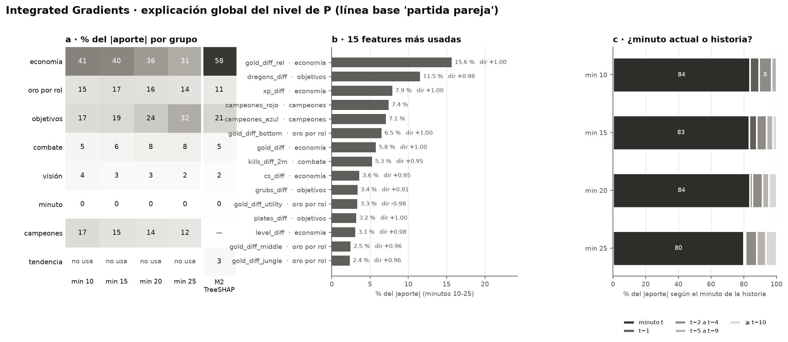
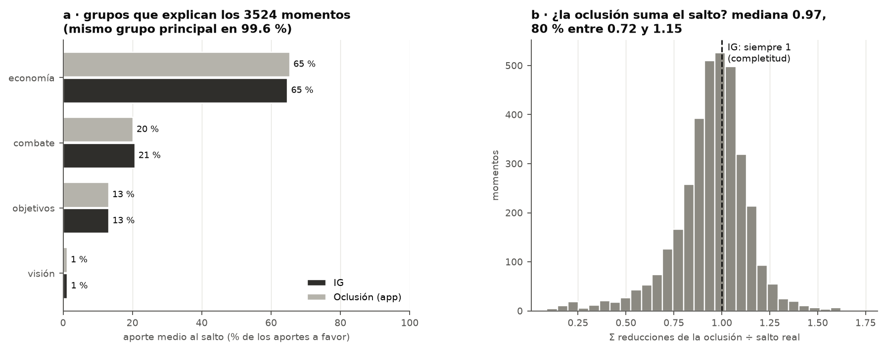

# Lab 10 · Parte 3 - resultados resultantes de `lab10_xai/explicar.py`

*Semilla 42 · IG 32 pasos · 1000 partidas de test para lo global · 219 s en total. No editar a mano: se regenera con el script.*

## Explicaciones locales

| caso | descripcion | match_id | minuto | desde_min | linea_base | p_azul | p_linea_base | delta_pts | gana | error_completitud | top4_pts |
|---|---|---|---|---|---|---|---|---|---|---|---|
| A | Acierto, alta confianza | EUW1_8035676835 | 15 | nan | pareja | 0.924 | 0.501 | 42.300 | azul | 0.000 | gold_diff_rel +12.1, dragons_diff +5.8, xp_diff +5.5, gold_diff +4.3 |
| B | Error, alta confianza | NA1_5673256745 | 15 | nan | pareja | 0.158 | 0.501 | -34.300 | azul | 0.000 | dragons_diff -11.8, campeones_rojo -9.2, gold_diff_rel -5.1, campeones_azul +4.2 |
| C | Cerca del umbral | KR_8445777853 | 15 | nan | pareja | 0.505 | 0.501 | 0.400 | azul | 0.000 | campeones_azul -10.1, dragons_diff +6.4, cs_diff +4.1, grubs_diff -3.8 |
| D | Subgrupo: con AFK | EUW1_8035556309 | 15 | nan | pareja | 0.402 | 0.501 | -9.900 | rojo | 0.000 | gold_diff_middle +8.3, dragons_diff -6.4, cs_diff -5.4, gold_diff_jungle -5.3 |
| E | Momento verdadero | KR_8444875248 | 20 | 18.0 | congelada | 0.517 | 0.286 | 23.100 | azul | 0.000 | gold_diff_rel +8.2, kills_diff_2m +7.6, gold_diff_utility -5.5, xp_diff +3.9 |
| F | Momento falso | KR_8444601933 | 5 | 3.0 | congelada | 0.419 | 0.755 | -33.600 | azul | 0.000 | gold_diff_rel -20.0, kills_diff_2m -4.5, level_diff -4.4, xp_diff -2.1 |

Notas humanas / eventos de los momentos:

- **E** (anotado en el min 21.0) nota: "El jungla del equipo azul mata al jungla del equipo rojo, asegurando un objetivo de barón sin dificultad. Con ese barón ejercen una gran presión en carriles mid y top." · eventos: azul: 5 kills, torre, torre; rojo: 3 kills
- **F** eventos: rojo: 3 kills

## Global (nivel de P)

Completitud: error máx 4.0e-04 logit (mediana |Δ logit| explicado 1.40).
El draft empuja hacia el equipo que terminó ganando en 53 % de las instancias.

| grupo | min 10 | min 15 | min 20 | min 25 | todos | M2 TreeSHAP (B12) |
|---|---|---|---|---|---|---|
| economía | 41.4 | 40.5 | 35.9 | 31.2 | 36.9 | 57.9 |
| oro por rol | 15.1 | 16.5 | 16.2 | 14.4 | 15.6 | 11.0 |
| objetivos | 17.5 | 19.1 | 23.6 | 31.6 | 23.4 | 21.1 |
| combate | 4.7 | 5.8 | 7.5 | 8.2 | 6.7 | 4.5 |
| visión | 4.0 | 3.0 | 2.7 | 2.4 | 3.0 | 2.0 |
| minuto | 0.0 | 0.0 | 0.0 | 0.0 | 0.0 | 0.3 |
| campeones | 17.4 | 15.1 | 14.1 | 12.2 | 14.5 | — |
| tendencia | — | — | — | — | — | 3.2 |

| feature | grupo | pct | direccion |
|---|---|---|---|
| gold_diff_rel | economía | 15.65 | 1.00 |
| dragons_diff | objetivos | 11.53 | 0.98 |
| xp_diff | economía | 7.91 | 1.00 |
| campeones_rojo | campeones | 7.44 | — |
| campeones_azul | campeones | 7.06 | — |
| gold_diff_bottom | oro por rol | 6.50 | 1.00 |
| gold_diff | economía | 5.76 | 1.00 |
| kills_diff_2m | combate | 5.26 | 0.95 |
| cs_diff | economía | 3.61 | 0.95 |
| grubs_diff | objetivos | 3.37 | 0.91 |
| gold_diff_utility | oro por rol | 3.35 | -0.98 |
| plates_diff | objetivos | 3.19 | 1.00 |
| level_diff | economía | 3.07 | 0.98 |
| gold_diff_middle | oro por rol | 2.46 | 0.96 |
| gold_diff_jungle | oro por rol | 2.36 | 0.96 |

% del |aporte| según el minuto de la historia:

| minuto | minuto t | t−1 | t−2 a t−4 | t−5 a t−9 | ≥ t−10 |
|---|---|---|---|---|---|
| 10 | 83.8 | 5.4 | 7.7 | 3.0 | 0.0 |
| 15 | 83.2 | 4.5 | 6.0 | 4.1 | 2.1 |
| 20 | 83.7 | 1.5 | 6.1 | 3.9 | 4.7 |
| 25 | 80.1 | 1.0 | 6.8 | 5.5 | 6.6 |

Subgrupos (minuto 15):

| subgrupo | n | economía | oro por rol | objetivos | combate | visión | minuto | campeones | acierto_% |
|---|---|---|---|---|---|---|---|---|---|
| todas | 1000 | 40.5 | 16.5 | 19.1 | 5.8 | 3.0 | 0.0 | 15.1 | 77.4 |
| parche 16.21 | 562 | 40.5 | 16.3 | 19.1 | 6.0 | 3.1 | 0.0 | 14.9 | 77.2 |
| parche 16.22 (no visto) | 438 | 40.4 | 16.8 | 19.0 | 5.6 | 2.9 | 0.0 | 15.3 | 77.6 |
| con AFK | 30 | 40.9 | 17.2 | 18.3 | 4.7 | 3.5 | 0.0 | 15.4 | 73.3 |
| silver | 159 | 42.5 | 16.5 | 18.9 | 5.8 | 3.0 | 0.0 | 13.3 | 73.6 |
| gold | 163 | 40.1 | 16.5 | 19.3 | 6.2 | 3.2 | 0.0 | 14.6 | 71.8 |
| platinum | 204 | 40.0 | 17.0 | 18.5 | 5.5 | 3.2 | 0.0 | 15.8 | 80.9 |
| emerald | 158 | 39.9 | 16.3 | 19.6 | 6.1 | 3.1 | 0.0 | 15.0 | 79.1 |
| diamond | 165 | 41.3 | 15.4 | 19.2 | 5.7 | 2.9 | 0.0 | 15.5 | 81.2 |
| master | 151 | 38.7 | 17.5 | 19.1 | 5.7 | 2.8 | 0.0 | 16.2 | 76.8 |
| aciertos |P−0.5| ≥ 0.3 | 434 | 47.6 | 15.1 | 16.9 | 6.1 | 2.5 | 0.0 | 11.8 | 100.0 |
| errores |P−0.5| ≥ 0.3 | 55 | 43.7 | 15.3 | 17.2 | 5.9 | 2.7 | 0.0 | 15.1 | 0.0 |

## Momentos: IG vs oclusión de la app

3524 momentos (θ* = 0.15). Mismo grupo principal: 99.6 %. Σ reducciones de la oclusión / salto: mediana 0.97 (p10 0.72, p90 1.15). Salto contrafactual / salto de la curva: mediana 1.01. Error de completitud máx 5.3e-04. Momentos con un grupo que empuja en contra del salto (≥ 10 % del Δ logit; la app lo recorta a 0): 5.1 %; con alguna feature en contra: 19.2 %. Momentos antes del minuto 5: 8.8 %.

| grupo | IG | Oclusión (app) | IG top-1 % | Oclusión top-1 % |
|---|---|---|---|---|
| economía | 64.8 | 65.4 | 89.8 | 89.4 |
| combate | 20.7 | 20.2 | 3.4 | 3.6 |
| objetivos | 13.2 | 13.2 | 6.8 | 7.0 |
| visión | 1.3 | 1.2 | 0.0 | 0.0 |

Feature que más empuja el salto (% de momentos):

| feature principal | minuto < 5 | minuto ≥ 5 |
|---|---|---|
| gold_diff_rel | 100.0 | 39.5 |
| kills_diff_2m | 0.0 | 36.6 |
| xp_diff | 0.0 | 7.8 |
| dragons_diff | 0.0 | 7.1 |
| towers_nexus_diff | 0.0 | 5.4 |
| inhibs_down_diff | 0.0 | 2.6 |
| baron_active | 0.0 | 0.3 |
| elder_active | 0.0 | 0.3 |
| n momentos | 311.0 | 3213.0 |

Momentos de las 28 partidas anotadas de test, según si caen en la zona de baja certeza:

| momento | n | pct_verdaderos |
|---|---|---|
| minuto ≥ 5 | 94 | 57.4 |
| minuto < 5 | 8 | 0.0 |

## Sensibilidad (minuto 15)

| variante | corr_rangos_grupos_mediana | mismo_grupo_top_% | corr_rangos_features_mediana | error_completitud_max | pct_economía | pct_oro por rol | pct_objetivos | pct_combate | pct_visión | pct_minuto | pct_campeones |
|---|---|---|---|---|---|---|---|---|---|---|---|
| referencia: 3 semillas, partida pareja, 32 pasos | 1 | 100 | 1 | 0.000256 | 40.7 | 16.6 | 18.5 | 6.13 | 3.1 | 0 | 15 |
| solo semilla 42 | 0.964 | 93.5 | 0.948 | 0.000317 | 38.3 | 17.5 | 17.7 | 7.64 | 3.75 | 0 | 15.1 |
| solo semilla 43 | 0.964 | 95 | 0.947 | 0.000311 | 40.2 | 15.1 | 18.2 | 6.06 | 2.87 | 0 | 17.5 |
| solo semilla 44 | 0.964 | 92.5 | 0.9 | 0.000313 | 40.5 | 16.3 | 18.1 | 6.23 | 3.08 | 0 | 15.8 |
| línea base 'todo en cero' (media de train, minuto incluido) | 1 | 99 | 0.967 | 0.000258 | 40.3 | 16.4 | 18.8 | 6.09 | 3.06 | 0.363 | 14.9 |
| 16 pasos | 1 | 100 | 1 | 0.00103 | 40.7 | 16.6 | 18.5 | 6.13 | 3.1 | 0 | 15 |
| 64 pasos | 1 | 100 | 1 | 6.2e-05 | 40.7 | 16.6 | 18.5 | 6.13 | 3.1 | 0 | 15 |

## Tiempos (CPU)

| tarea | n | ms_por_instancia |
|---|---|---|
| IG nivel, minuto 10 (batch de 32) | 1000 | 6.2 |
| IG nivel, minuto 15 (batch de 32) | 1000 | 8.3 |
| IG nivel, minuto 20 (batch de 32) | 930 | 11.8 |
| IG nivel, minuto 25 (batch de 32) | 809 | 16.4 |
| IG momento (1 a la vez) | 3524 | 37.6 |
| Oclusión de la app por momento | 3524 | 6.6 |
