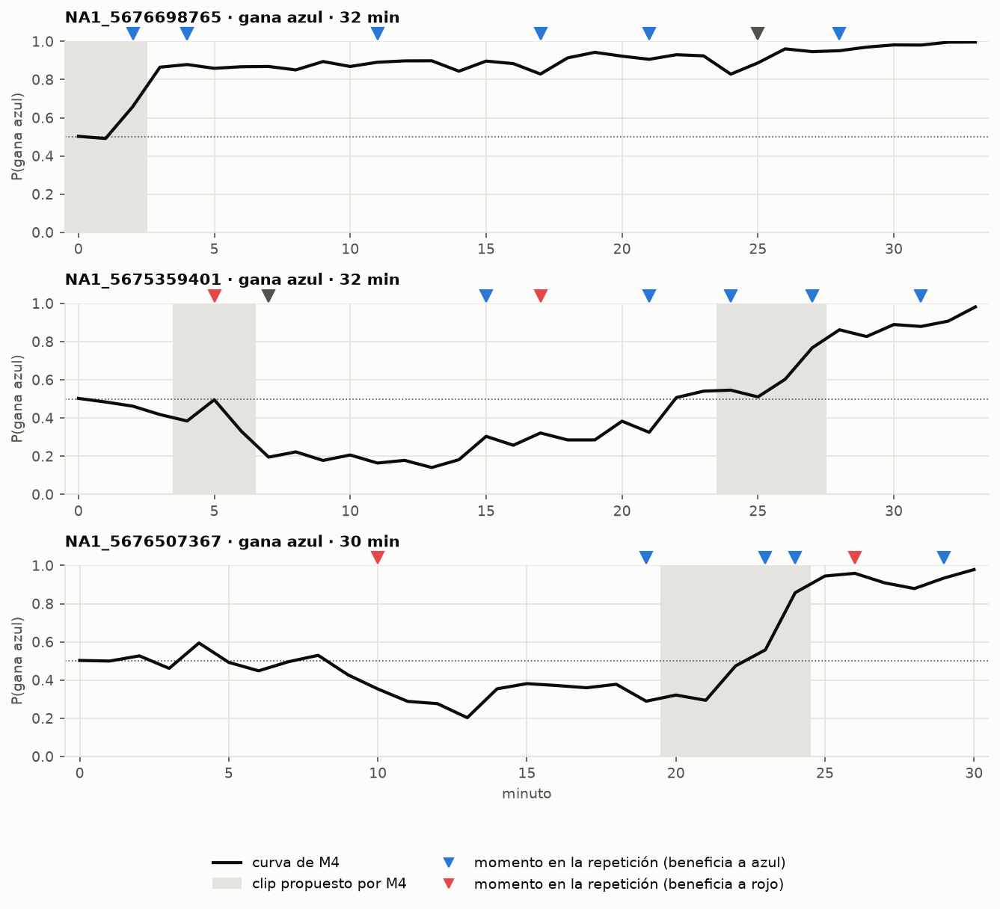

# Partidas propias: modelo vs momentos vistos en la repetición

*`python src/predict_matches.py`. Modelo M4 con θ* = 0.23 (elegido en val por B10), emparejado a ±2 min. Momentos humanos de `annotations/revisiones_momentos.csv` (solo `es_momento = True`). Estas partidas no están en el entrenamiento.*

| Partida | Gana | Momentos en la repetición | Clips del modelo | Coinciden | FP | FN | R0: coinciden / clips |
|---|---|---|---|---|---|---|---|
| NA1_5676698765 | azul | 8 | 1 | 1 | 0 | 7 | 3 / 4 |
| NA1_5675359401 | azul | 8 | 2 | 2 | 0 | 6 | 3 / 4 |
| NA1_5676507367 | azul | 6 | 2 | 2 | 0 | 4 | 4 / 5 |

**Total:** M4 precisión 1.00, recall 0.23, F1 0.37 (en las coincidencias, mismo equipo 5/5). R0: precisión 0.77, recall 0.45, F1 0.57.

> Son 3 partidas: sirve como ilustración y para la demo, no como métrica.

## Detalle por partida

### NA1_5676698765 (gana azul)

Clips de M4 (minuto de la jugada):
- min 0–2: P(azul) 0.49 → 0.86 (favorece a azul)

Vistos en la repetición:
- min 2 · otro · azul · Darius juega mejor, sobrevive a un gank
- min 4 · error · azul · Ahri (rojo) juega mal ('troll')
- min 4~ · pelea · azul · Darius doble kill
- min 11 · error · azul · Problemas en top y mid de rojo
- min 17 · objetivo · azul · Peor momento: pelea que termina en objetivo, azul gana el heraldo
- min 21 · error · azul · Pudo ser media remontada de rojo, pero tras la pelea no regresaron a comprar y no había objetivos
- min 25~ · objetivo · ? · Buen barón (equipo no indicado)
- min 28 · pick · azul · Pick a Senna (support de rojo), rojo no pudo pelear el barón

### NA1_5675359401 (gana azul)

Clips de M4 (minuto de la jugada):
- min 4–6: P(azul) 0.50 → 0.20 (favorece a rojo)
- min 24–27: P(azul) 0.60 → 0.86 (favorece a azul)

Vistos en la repetición:
- min 5 · pelea · rojo · Pelea a favor de rojo (shutdown) y dragón por eso
- min 7 · otro · ? · Jungla presente (minutos 7 y 8)
- min 15 · error · azul · Mal dive del equipo rojo
- min 17 · error · rojo · Error de azul: el support empezó la pelea en la jungla rival
- min 21 · pelea · azul · Pelea a favor de azul (shutdown), por eso dragón y torre de top
- min 24 · pick · azul · Pick de azul al jungla rojo y barón gratis
- min 27 · pelea · azul · Pelea a favor de azul, empieza el snowball para terminar la partida
- min 31 · objetivo · azul · Barón para terminar

### NA1_5676507367 (gana azul)

Clips de M4 (minuto de la jugada):
- min 20–22: P(azul) 0.29 → 0.56 (favorece a azul)
- min 21–24: P(azul) 0.56 → 0.94 (favorece a azul)

Vistos en la repetición:
- min 10 · pelea · rojo · Pelea a favor del equipo rojo
- min 19 · pelea · azul · Pelea a favor de azul: el bottom gana oro con dos kills seguidas
- min 23 · objetivo · azul · Pelea totalmente a favor de azul por el objetivo, buena coordinación de definitivas
- min 24 · pick · azul · Triple kill del bottom azul que termina en barón gratis
- min 26 · error · rojo · Azul cede 2 muertes sin aprovechar el barón que acababa de sacar
- min 29 · pelea · azul · Pelea totalmente a favor de azul, termina la partida
