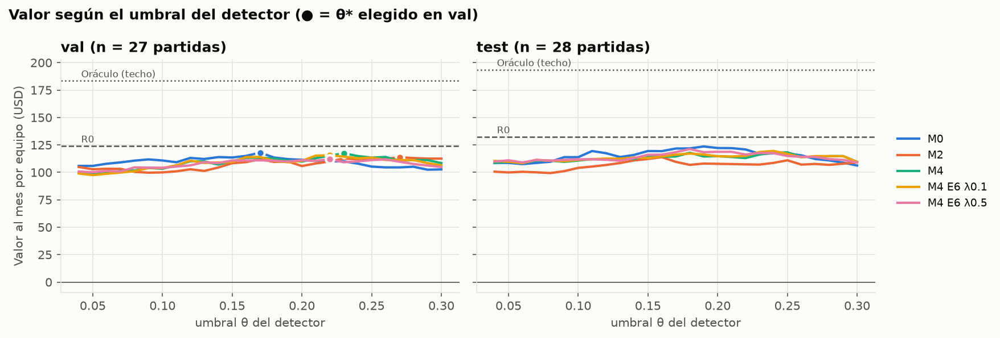
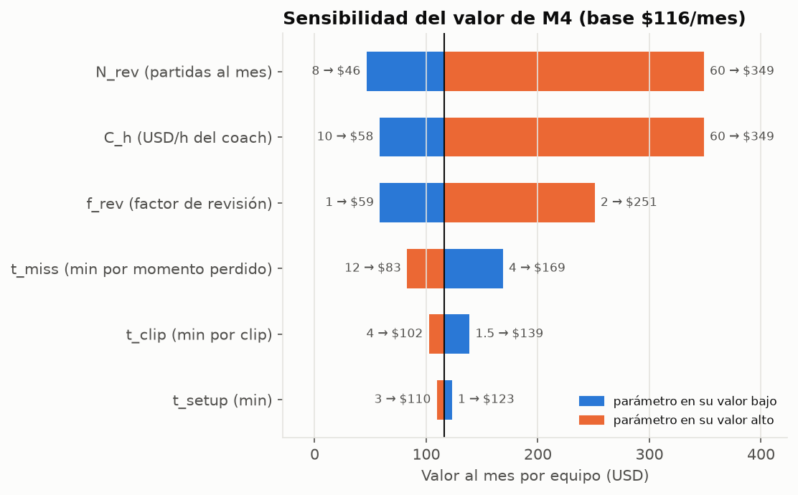

# B10 · Modelo de valor: resultados

*Generado por `python src/value_model.py `. Se vuelve a correr cuando haya más anotaciones.*

## Datos

- Partidas anotadas con predicciones: **27 de val** (para elegir θ*) y **28 de test** (para reportar). Anotadores: A 35, B 35. Compartidas (A y B): 15.
- Momentos anotados por partida: 2.5; partidas sin momentos: 13 %. Confianza mínima usada: 1.
- Duración media de esas partidas: 28.9 min → revisión completa T_base = 1.3 × 28.9 = **38 min**.
- Tiempo medio de anotar una partida con la herramienta (solo el log): 9.3 min.
- Parámetros: f_rev 1.3, t_setup 2.0, t_clip 2.5, t_miss 8.0, N_rev 20, C_h USD 20 (`configs/value.yaml`).

## Tabla principal (test, θ* elegido en val)

| Modelo | θ* | Clips/partida | Precisión | Recall | F1 | Ahorro (min/partida) | Ahorro % | Valor USD/mes [IC 95 %] | Δ vs M0 [IC 95 %] |
|---|---|---|---|---|---|---|---|---|---|
| R0 | — | 3.9 | 0.48 | 0.71 | 0.57 | 19.9 | 53 % | 132 [111, 152] | +11 [-8, +30] |
| M0 | 0.17 | 2.2 | 0.51 | 0.43 | 0.47 | 18.3 | 49 % | 122 [92, 152] | — |
| M1 | 0.27 | 1.5 | 0.43 | 0.25 | 0.31 | 16.2 | 43 % | 108 [77, 138] | -14 [-24, -4] |
| M2 | 0.27 | 1.6 | 0.42 | 0.26 | 0.32 | 16.1 | 43 % | 108 [77, 138] | -14 [-25, -3] |
| M3 | 0.23 | 2.1 | 0.40 | 0.33 | 0.36 | 16.3 | 43 % | 109 [81, 137] | -13 [-25, -1] |
| **M4** | 0.23 | 1.9 | 0.49 | 0.35 | 0.41 | 17.4 | 46 % | 116 [84, 147] | -5 [-17, +6] |
| M5 | 0.17 | 3.2 | 0.41 | 0.50 | 0.45 | 17.2 | 46 % | 115 [86, 142] | -7 [-20, +8] |
| M4 E6 λ0.1 | 0.22 | 1.9 | 0.47 | 0.35 | 0.40 | 17.3 | 46 % | 115 [82, 146] | -7 [-19, +6] |
| M4 E6 λ0.5 | 0.22 | 1.6 | 0.52 | 0.32 | 0.39 | 17.4 | 46 % | 116 [84, 146] | -5 [-18, +6] |
| Oráculo | — | 2.6 | 1.00 | 1.00 | 1.00 | 29.0 | 77 % | 194 [171, 216] | +72 [+54, +90] |

*Oráculo* = detector perfecto (marca exactamente lo anotado): es el techo del ahorro con estos parámetros. R0 = regla sin ML (barón, ace, inhibidor o swing de oro > 1,500).

## Sensibilidad (M4, θ* re-elegido en cada caso)

| Parámetro | Valor bajo → USD/mes | Valor alto → USD/mes | ¿Cambia el ganador? |
|---|---|---|---|
| f_rev (factor de revisión) | 1 → 59 | 2 → 251 | no |
| t_setup (min) | 1 → 123 | 3 → 110 | no |
| t_clip (min por clip) | 1.5 → 139 | 4 → 102 | sí: M4 E6 λ0.1 |
| t_miss (min por momento perdido) | 4 → 169 | 12 → 83 | sí: M4 |
| N_rev (partidas al mes) | 8 → 46 | 60 → 349 | no |
| C_h (USD/h del coach) | 10 → 58 | 60 → 349 | no |

Ganador con los valores base: **R0**. Escenario pesimista (f_rev 1.0, t_clip 4, t_miss 12): M4 -5 USD/mes, gana R0. Optimista (f_rev 2.0, t_clip 1.5, t_miss 4): 308 USD/mes, gana R0. Los ±20 % y ±50 % de cada parámetro están en `results/b10_tornado.csv`.

## Punto de equilibrio (M4)

- El sistema ahorra tiempo mientras **f_rev > 0.70** (revisar la partida completa toma más que 0.70 min por minuto de juego) y mientras **t_clip < 11.9 min** por clip.
- Para pagar una suscripción de USD 8/mes basta con revisar **1.4 partidas al mes** (con C_h = 20), o un coach de **USD 1.38/h** (con N_rev = 20).
