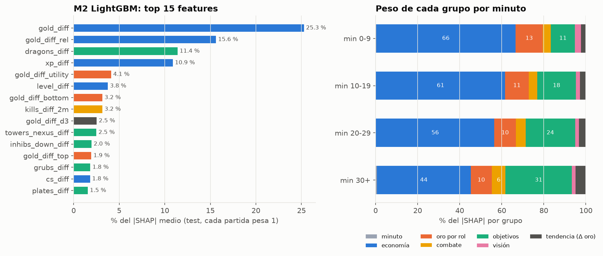
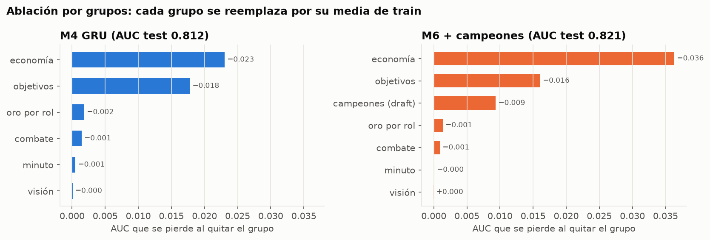

# B12 · Explicabilidad: SHAP de LightGBM y ablación por grupos

*`python src/b12_resultados.py --solo shap ablacion`. Partidas de test (4,032). Cada partida pesa 1 (filas con peso 1/duración).*

## SHAP global de LightGBM (M2)

TreeSHAP exacto de LightGBM (`pred_contrib=True`) sobre una muestra de 60,000 filas (partida × minuto) de test. *Dirección* = correlación entre el valor de la feature y su SHAP (+1: más alto → más probable que gane azul).

| # | Feature | Grupo | % del \|SHAP\| | Dirección |
|---|---|---|---|---|
| 1 | `gold_diff` | economía | 25.3 % | +0.98 |
| 2 | `gold_diff_rel` | economía | 15.6 % | +0.98 |
| 3 | `dragons_diff` | objetivos | 11.4 % | +0.97 |
| 4 | `xp_diff` | economía | 10.9 % | +0.92 |
| 5 | `gold_diff_utility` | oro por rol | 4.1 % | -0.90 |
| 6 | `level_diff` | economía | 3.8 % | +0.91 |
| 7 | `gold_diff_bottom` | oro por rol | 3.2 % | +0.89 |
| 8 | `kills_diff_2m` | combate | 3.2 % | +0.85 |
| 9 | `gold_diff_d3` | tendencia (Δ oro) | 2.5 % | +0.94 |
| 10 | `towers_nexus_diff` | objetivos | 2.5 % | +0.93 |
| 11 | `inhibs_down_diff` | objetivos | 2.0 % | +0.96 |
| 12 | `gold_diff_top` | oro por rol | 1.9 % | -0.59 |
| 13 | `grubs_diff` | objetivos | 1.8 % | +0.86 |
| 14 | `cs_diff` | economía | 1.8 % | +0.63 |
| 15 | `plates_diff` | objetivos | 1.5 % | +0.89 |

**Por grupo (global):** economía 58 % · objetivos 21 % · oro por rol 11 % · combate 5 % · tendencia (Δ oro) 3 % · visión 2 % · minuto 0 %

**Por tramo de minuto (% del |SHAP|):**

| Grupo | min 0-9 | min 10-19 | min 20-29 | min 30+ |
|---|---|---|---|---|
| economía | 66 % | 61 % | 56 % | 44 % |
| objetivos | 11 % | 18 % | 24 % | 31 % |
| oro por rol | 13 % | 11 % | 10 % | 10 % |
| combate | 4 % | 4 % | 5 % | 6 % |
| tendencia (Δ oro) | 2 % | 3 % | 3 % | 5 % |
| visión | 3 % | 2 % | 2 % | 2 % |
| minuto | 0 % | 0 % | 0 % | 1 % |

## Ablación por grupos en los modelos secuenciales (M4 GRU y M6 + campeones)

Cada grupo se reemplaza por 0 en todos los minutos (= su media de train, porque las features están estandarizadas) y se mide el AUC y el log-loss en test. Es la misma idea que la explicación por momento de la app (`app/inference.py`, `explain`), pero sobre todo test. Los modelos secuenciales no usan el grupo *tendencia* (la historia ya la ven).

| Modelo | Grupo quitado | AUC | ΔAUC | Log-loss | ΔLog-loss |
|---|---|---|---|---|---|
| M4 GRU | ninguno | 0.8124 | +0.0000 | 0.5204 | +0.0000 |
| M4 GRU | combate | 0.8110 | -0.0014 | 0.5212 | +0.0008 |
| M4 GRU | minuto | 0.8119 | -0.0005 | 0.5215 | +0.0011 |
| M4 GRU | economía | 0.7894 | -0.0230 | 0.5589 | +0.0385 |
| M4 GRU | objetivos | 0.7947 | -0.0178 | 0.5412 | +0.0208 |
| M4 GRU | oro por rol | 0.8106 | -0.0019 | 0.5215 | +0.0012 |
| M4 GRU | visión | 0.8124 | -0.0001 | 0.5201 | -0.0003 |
| M6 + campeones | ninguno | 0.8207 | +0.0000 | 0.5112 | +0.0000 |
| M6 + campeones | combate | 0.8198 | -0.0009 | 0.5117 | +0.0006 |
| M6 + campeones | minuto | 0.8206 | -0.0001 | 0.5120 | +0.0008 |
| M6 + campeones | economía | 0.7844 | -0.0363 | 0.5636 | +0.0524 |
| M6 + campeones | objetivos | 0.8046 | -0.0161 | 0.5306 | +0.0194 |
| M6 + campeones | oro por rol | 0.8193 | -0.0014 | 0.5119 | +0.0007 |
| M6 + campeones | visión | 0.8207 | +0.0000 | 0.5109 | -0.0002 |
| M6 + campeones | campeones (draft) | 0.8114 | -0.0094 | 0.5240 | +0.0128 |

