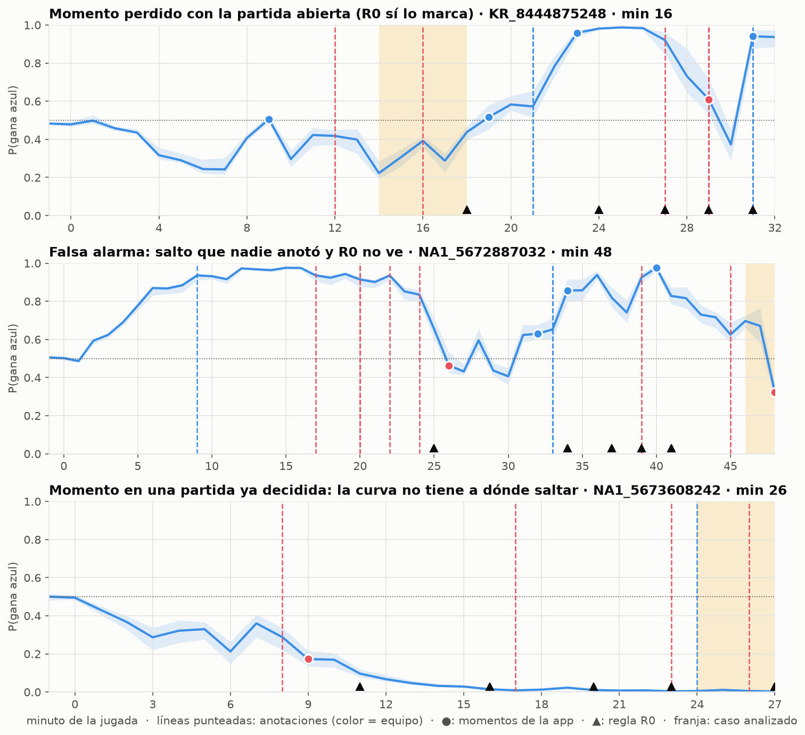

# B12 · Casos de falla del detector de la app

*`python src/b12_resultados.py --solo fallas`. Detector de la app: M6 + campeones (promedio de 3 semillas), θ* = 0.15. 28 partidas anotadas de test; un acierto es una detección a ±2 min de una anotación (minuto detectado − 1 = minuto de la jugada).*

## Resumen de errores en test

- Momentos anotados (contando cada anotador): **94**, detectados 60 (64 %); la regla R0 detecta 69 (73 %). Aquí una detección puede cubrir dos anotaciones cercanas (sin emparejar uno a uno), por eso sale más alto que el recall de `results/mejoras.md`.
- Detectados con el equipo correcto: 43 de 60.
- Perdidos por la app pero vistos por R0: 22; al revés: 13.
- Momentos perdidos: salto máximo cerca del minuto anotado, mediana 9.0 pts (θ* = 15 pts); 27 pasan con la curva ya en < 20 % o > 80 %.
- **Por qué se pierden los 34 momentos no detectados:** partida ya decidida (curva < 20 % o > 80 %) 27 (79 %); salto menor que θ* con la partida abierta 5 (15 %); hubo salto ≥ θ* pero el clip quedó en otro minuto (fuera del top 5 o fusionado con un vecino) 2 (6 %).
- Detecciones de la app: 102, sin ninguna anotación cerca 48 (47 %).

## Caso 1. Momento perdido con la partida abierta (R0 sí lo marca)

**KR_8444875248**, minuto 16 de la jugada. Gana azul, 32.1 min.

**Lo que anotamos en la partida:**

- A, min 21, pick, favorece a azul (confianza 3): El jungla del equipo azul mata al jungla del equipo rojo, asegurando un objetivo de barón sin dificultad. Con ese barón ejercen una gran presión en carriles mid y top.
- A, min 27, error, favorece a rojo (confianza 3): Mala jugada por parte del equipo azul, que llevan amplia ventaja de mapa, termina en ACE y barón a favor del equipo rojo. 
- A, min 29, pelea, favorece a rojo (confianza 3): Pelea que termina en una penta-kill a favor del bottom del equipo rojo, creando una gran ventaja de oro para el carry y tirando torre e inhibidor en el carril central. 
- A, min 31, error, favorece a azul (confianza 3): Error del equipo rojo de estar separados y no estabilizar la situación, luego de haber tenido la pelea ventajosa previa. Mueren todos (el jungla estaba tirando torre en top), el equipo azul hace alma de dragón y terminan la partida.  
- B, min 12, pelea, favorece a rojo (confianza 2): Katarina fideeada
- B, min 16, estructura, favorece a rojo (confianza 2): Buena pelea que permite derribar torres
- B, min 21, pick, favorece a azul (confianza 3): Pelea entre junglas que permite obtener el barón y permite pushear hasta el minuto 25
- B, min 29, pelea, favorece a rojo (confianza 2): Penta de katarina pero mala ejecución de equipo, no realizan ningun objetivo o pushean en grupo
- B, min 31, objetivo, favorece a azul (confianza 2): Buena respuesta del push del equipo rojo, con objetivo terminado y push suficiente que el equipo rojo dio por terminada la partida aunque pusieron revivir y pelear

**Lo que marcó la app:** min 9 (azul, +26 pts, economía); min 19 (azul, +23 pts, economía); min 23 (azul, +39 pts, economía); min 29 (rojo, -31 pts, economía); min 31 (azul, +57 pts, objetivos)

**Regla R0:** min 18, min 24, min 27, min 29, min 31

**Eventos alrededor del min 16 (±2):** azul: 8 kills, estructuras: torre, torre, torre · rojo: 10 kills, objetivos: dragón, heraldo, estructuras: torre, torre

**Medido:** el mayor salto de la curva cerca de ese minuto fue de 19.5 pts (θ* = 15 pts); antes del salto la curva estaba en 40 %.

**Diagnóstico:** La curva sí saltó 19.5 pts (≥ θ*) cerca de ese minuto, pero la partida tuvo más de 5 saltos grandes y el detector solo muestra los 5 mayores (`top_k`, para no darle al coach demasiados clips). En una partida muy movida el límite deja fuera momentos reales.

## Caso 2. Falsa alarma: salto que nadie anotó y R0 no ve

**NA1_5672887032**, minuto 48 de la jugada. Gana rojo, 49.0 min.

**Lo que anotamos en la partida:**

- A, min 33, objetivo, favorece a azul (confianza 3): Pelea a favor del equipo azul, para hacerse la bonificación del barón.
- A, min 17, pick, favorece a rojo (confianza 3): El mid del equipo rojo logra matar al jungla del equipo azul, asegurando entonces el dragon facilmente para su jungla.
- A, min 20, error, favorece a rojo (confianza 2): Se exponen mucho a pesar de estar ganando por ventaja, lo que le regala una triple-kill al top del equipo rojo.
- A, min 24, error, favorece a rojo (confianza 3): El equipo azul, principalmente el bottom de ellos (quien es el más fuerte), se expone a una mala pelea, que queda totalmente a favor del equipo rojo, incluyendo un dragón y un barón luego. ACE a favor del equipo rojo
- A, min 45, pelea, favorece a rojo (confianza 3): Pelea para defender la torre de top del equipo rojo, que termina en una balanza totalmente a favor de ellos, suficiente para terminar la partida. 
- B, min 9, pick, favorece a azul (confianza 2): Pelea de junglas que permite que el equipo azul gane las larvas
- B, min 20, pelea, favorece a rojo (confianza 2): Asesinato triple del olaf, remontada en top 
- B, min 22, estructura, favorece a rojo (confianza 2): El yi se empezó a armar y escalar, logró un asecinato doble junto con el supp y el top, permite mantener un excelente push y ganar dragones y torretas
- B, min 33, objetivo, favorece a azul (confianza 2): Buena pelea que pemitió pelear un objetivo, logran pushear, se miran las consecuencias del barón sobre el equipo rojo con asecinatos estructuras y dragón
- B, min 39, error, favorece a rojo (confianza 3): Buen push de parte del equipo azul, pero forzaron a cerrar la partida, no consideraron el barón ni que el Yi podia revivir o backear, y los mató a todos porque los Yi escalan y estan en late, eso permitió que el yi los matara a todos, hiciera un barón, elder y finalizzar la partida (error, llegar a late con un yi en el equipo contrario) o pushear sin fuerza como baron

**Lo que marcó la app:** min 26 (rojo, -37 pts, economía); min 32 (azul, +22 pts, combate); min 34 (azul, +23 pts, economía); min 40 (azul, +23 pts, objetivos); min 48 (rojo, -38 pts, objetivos)

**Regla R0:** min 25, min 34, min 37, min 39, min 41

**Eventos alrededor del min 48 (±2):** azul: 2 kills · rojo: 5 kills, objetivos: ace, estructuras: torre, inhibidor, torre

**Medido:** salto de -37.5 pts a favor de rojo; la explicación de la app lo atribuye a *objetivos*. Texto de la app: "min 47–49: 37 pts de probabilidad a favor de rojo, sobre todo por objetivos (azul: 2 kills; rojo: 5 kills, ace, 2× torre, inhibidor)"

**Diagnóstico:** La app marca el **cierre de la partida**: en los últimos minutos el ganador tira torres e inhibidor y la curva termina de irse a 0 o a 1, así que siempre hay un salto grande. Para el coach ese clip casi no aporta (la partida ya se decidió antes), y los anotadores marcamos la pelea que la decidió, no el cierre. Arreglo posible: no marcar momentos en los últimos 2–3 minutos, o solo si la curva cruza el 50 %.

## Caso 3. Momento en una partida ya decidida: la curva no tiene a dónde saltar

**NA1_5673608242**, minuto 26 de la jugada. Gana rojo, 27.7 min.

**Lo que anotamos en la partida:**

- B, min 8, objetivo, favorece a rojo (confianza 2): Objetivo de larvas y rotación del jungla a mid para asesinato doble
- B, min 17, pick, favorece a rojo (confianza 3): Karma mató a taliyah, Rakan y Jhin, dejó expuesta a la shyvana y el team azul ya no pudo pelear el dragón
- B, min 23, objetivo, favorece a rojo (confianza 2): Xayah tripe asesinato, aunque pierden dragón genera ventaja para generar presión en las torretas
- B, min 24, pelea, favorece a azul (confianza 2): Pelea que mejora el marcador del euqipo azul
- B, min 26, objetivo, favorece a rojo (confianza 3): Barón que genera la ventaja completa y marca el final de la partida 

**Lo que marcó la app:** min 9 (rojo, -19 pts, economía)

**Regla R0:** min 11, min 16, min 20, min 23, min 27

**Eventos alrededor del min 26 (±2):** azul: 5 kills · rojo: 9 kills, objetivos: barón, ace, estructuras: torre, torre, inhibidor, torre, torre, inhibidor

**Medido:** el mayor salto de la curva cerca de ese minuto fue de 0.9 pts (θ* = 15 pts); antes del salto la curva estaba en 0 %.

**Diagnóstico:** Antes del momento la curva ya estaba en 0 %: la partida ya estaba decidida y la probabilidad casi no tiene a dónde moverse (salto máximo 0.9 pts). El momento es real (lo anotamos y R0 lo marca porque mira los eventos), pero un detector de saltos de probabilidad es ciego a él. Para el coach no es grave: confirma un resultado que se decidió antes, y ese momento anterior sí suele estar marcado.

