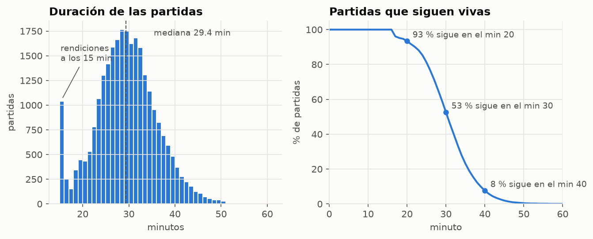
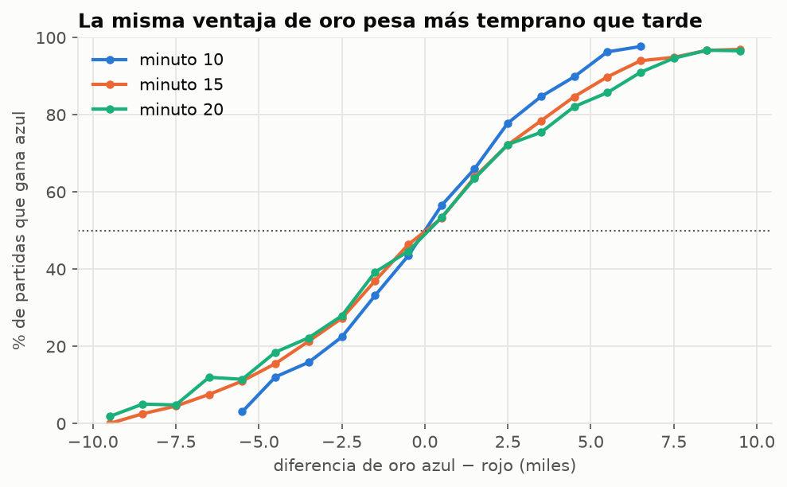
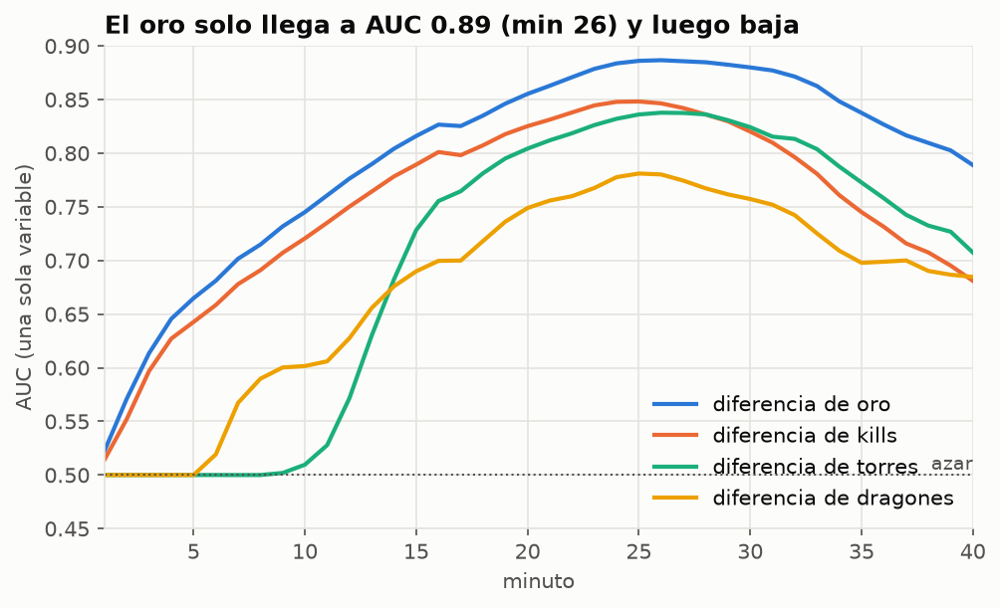
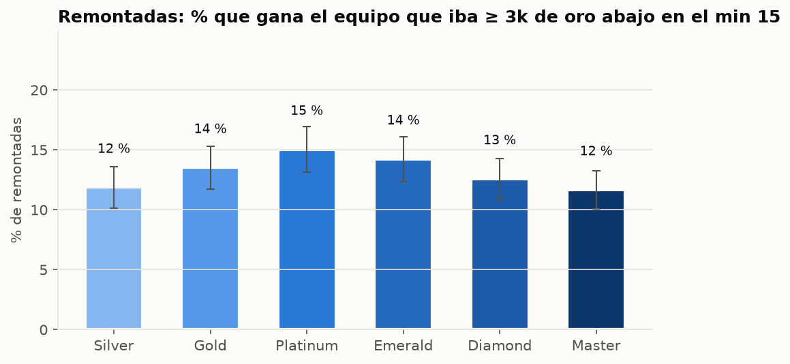
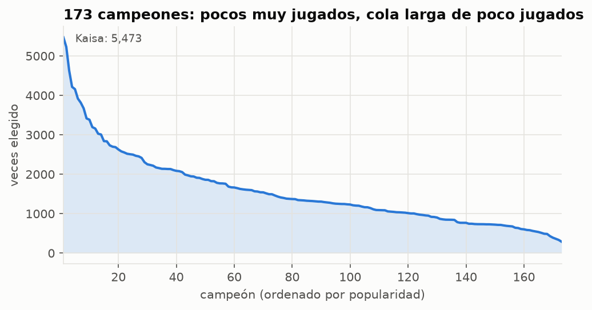
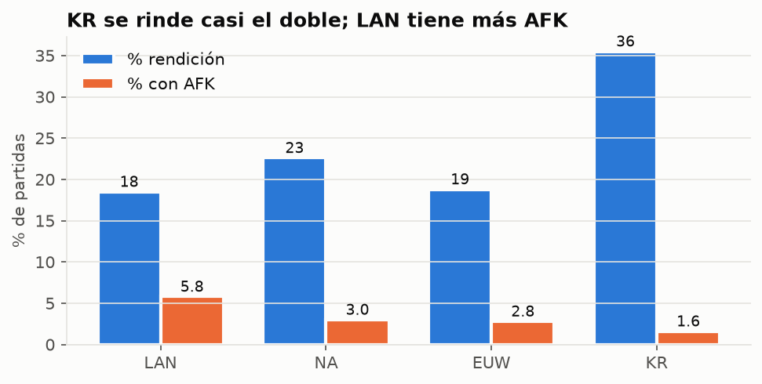

# B4 - Análisis exploratorio de datos

*Generado por `src/eda.py`. Relaciones con el resultado: solo partidas de **train** (18,912). Conteos descriptivos: las 27,000 partidas.*

## 1. Duración y supervivencia

- Duración media 29.5 min (p5 17.4, p95 40.5). El mínimo es 15 min porque `collect.py` descarta remakes y partidas más cortas.
- El pico en 15–16 min (1,040 partidas, 3.9 %) son **rendiciones en cuanto se habilita la votación**: partidas que se decidieron muy temprano. Ahí el "momento decisivo" está antes del minuto 15.
- Solo el 53 % de las partidas llega al minuto 30 y el 8 % al 40. **Consecuencia para la evaluación:** las métricas de minutos tardíos se calculan con pocas partidas, y además con partidas *parejas* (las desbalanceadas terminan antes). Hay que reportar métricas por tramo de minuto con su número de partidas.

## 2. ¿Qué predice la victoria? (solo train)

- **La diferencia de oro sola** ya da AUC 0.745 en el minuto 10, 0.816 en el 15 y 0.855 en el 20. Es el baseline M0: cualquier modelo complejo tiene que superar esto para justificarse.
- **La misma ventaja de oro pesa más temprano que tarde:** un equipo que va +5.5k gana el 96 % de las veces si es el minuto 10, contra 86 % si es el minuto 20 (la curva del minuto 10 es la más empinada). Una ventaja fija es mayor en proporción cuando hay menos oro total en juego. Implicaciones: (1) el modelo necesita el minuto como entrada, porque una regla fija "+2k de oro = X %" no sirve para toda la partida; (2) conviene la feature de **oro relativo** (diferencia / oro total de ambos equipos), ya prevista en B3.
- Después del minuto ~26 el AUC del oro **baja** (0.887 → 0.789 en el 40): las partidas que siguen vivas son las parejas, y en partidas largas el oro importa menos que los objetivos (barón, elder, inhibidores). Esto justifica usar objetivos y un modelo que combine información, no solo oro.
- La XP se comporta casi igual que el oro (están muy correlacionadas); las torres ganan importancia después del minuto 15.

## 3. Remontadas por tier (solo train)

| tier | partidas | % remonta | ± IC95 |
|---|---|---|---|
| SILVER | 1357 | 11.9 | 1.7 |
| GOLD | 1413 | 13.5 | 1.8 |
| PLATINUM | 1383 | 15.0 | 1.9 |
| EMERALD | 1334 | 14.2 | 1.9 |
| DIAMOND | 1439 | 12.6 | 1.7 |
| MASTER | 1526 | 11.7 | 1.6 |

- Remontar desde −3k en el minuto 15 es raro en todos los tiers (12–15 %). Los intervalos de confianza se solapan, así que **no hay evidencia fuerte de que el elo bajo remonte más** que el alto. Hipótesis para E3/E5: un modelo entrenado con todos los tiers no debería descalibrarse mucho por tier; hay que confirmarlo midiendo la calibración por grupo.

## 4. Cuándo ocurren los objetivos (minuto)

| evento | 25% | 50% | 75% | % de partidas |
|---|---|---|---|---|
| primera_kill | 1.5 | 2.1 | 2.6 | 100.0 |
| primer_dragon | 6.5 | 7.8 | 9.8 | 99.9 |
| primera_torre | 12.5 | 13.7 | 14.8 | 99.9 |
| primer_baron | 22.2 | 24.2 | 26.8 | 77.3 |

Mediana por tier:

| tier | primer_dragon | primera_torre | primer_baron |
|---|---|---|---|
| SILVER | 7.7 | 13.7 | 25.8 |
| GOLD | 7.7 | 13.7 | 25.3 |
| PLATINUM | 7.8 | 13.7 | 24.8 |
| EMERALD | 7.8 | 13.7 | 24.1 |
| DIAMOND | 7.8 | 13.7 | 23.2 |
| MASTER | 7.9 | 13.4 | 22.7 |

- La primera kill llega muy temprano (mediana 2.1 min), pero los objetivos grandes tardan: primer dragón ~7.8, primera torre ~13.7 y barón ~24.2 (solo en el 77 % de las partidas). Antes del minuto ~5 hay poca información: el AUC del oro sigue por debajo de 0.67 y la app debe marcar esos minutos como "baja certeza".
- El barón se toma antes en elo alto (mediana 25.8 min en Silver vs 22.7 en Master): los jugadores de alto elo convierten ventajas en objetivos más rápido.

## 5. Campeones y roles

- 173 campeones distintos. Los 20 más jugados suman el 26 % de las elecciones; el menos jugado aparece 289 veces (0 campeones con menos de 100).
- **Implicación para M6 (embeddings de campeones):** todos los campeones tienen al menos ~289 apariciones en 27k partidas (unas 202 en train), suficiente para aprender embeddings pequeños (8–16 dimensiones) con dropout. Aun así, el draft solo suele predecir poco: M6 es "Podría", no prioridad.
- Roles: TOP 53,999, BOTTOM 53,999, JUNGLE 53,998, MIDDLE 53,997, UTILITY 53,996, vacío 11.

## 6. Diferencias entre regiones

| región | partidas | % gana azul | % rendición | % con AFK | duración media (min) |
|---|---|---|---|---|---|
| LAN | 6750 | 50.8 | 18.5 | 5.8 | 30.6 |
| NA | 6750 | 49.6 | 22.6 | 3.0 | 29.7 |
| EUW | 6750 | 49.9 | 18.8 | 2.8 | 29.7 |
| KR | 6750 | 50.6 | 35.5 | 1.6 | 27.9 |

- **No hay sesgo de lado:** azul gana ~50 % en todas las regiones (ver IC en `results/b2_resumen.md`), así que la etiqueta está balanceada.
- Las regiones se comportan distinto (rendiciones, AFK, duración). Un modelo entrenado con todo puede calibrar peor en alguna región: es la base de E4 y de la evaluación por región (E5).

## 7. Calidad, nulos y fugas de información

- Nulos (verificado): `frames.csv` y `matches.csv` no tienen ningún nulo; `participants.csv` solo tiene 11 `team_position` vacíos (se reemplazan por `UNKNOWN`). Las columnas vacías de `events.csv` son esperadas (cada tipo de evento usa solo algunas).
- Partidas con AFK (3.3 %) y ejecuciones: ver `results/b2_resumen.md`.
- **Prueba de cordura de fuga:** en el minuto 1 el AUC del oro es 0.523: casi azar, como debe ser porque aún no pasa nada. Si un modelo da AUC alto en los minutos 0–2, hay una fuga.
- Variables que **nunca** deben ser features (contienen el resultado o el futuro): `duration_s`, `n_frames`, `ended_in_surrender`, `win`, las estadísticas finales de `participants.csv`, el evento `GAME_END` y cualquier evento posterior al minuto que se predice. Lista completa en la guía, sección 3.3.
