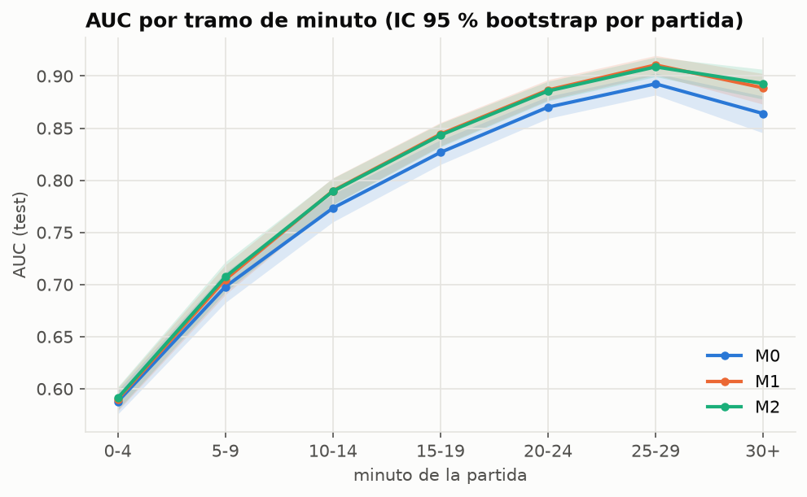
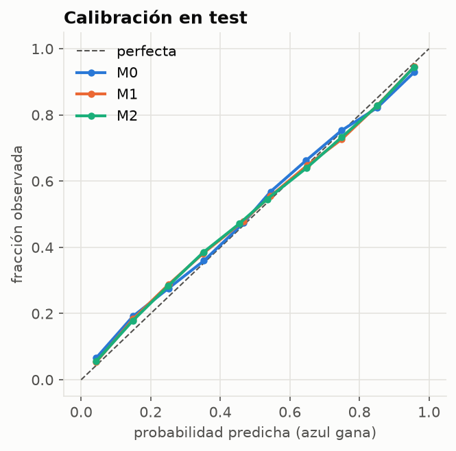

# B3 + B5 · Features y baselines

*7 nov 2026. Se reproduce con:*
```
python src/build_features.py                 # B3, ~5 min → features/
python src/baselines.py                      # M0, M1, M2 + cordura, ~1 min (CPU)
python src/evaluate.py --run results/runs/m0_oro results/runs/m1_logit results/runs/m2_lgbm --name M0 M1 M2
```

## B3 · Features (`src/features.py`)

- `features/sequences.npz`: X [27,000 × 60 × 35], cumple `docs/contrato_features.md` (lo valida `load_sequences`). Pesa 51 MB.
- `features/team_minute.csv`: 836,617 filas (partida × minuto) con las features **crudas** (sin normalizar).
- `features/scaler.json`: media y desviación ajustadas **solo con train sin AFK**. La app debe usar `Scaler.load(...)`.
- Cordura: AUC de la diferencia de oro en train = 0.748 / 0.818 / 0.857 en los minutos 10 / 15 / 20. El EDA de B4 dio 0.745 / 0.816 / 0.855.

| Grupo | Features (todas azul − rojo, causales) |
|---|---|
| contexto | `minute` |
| economia | `gold_diff`, `gold_diff_rel` (dif / oro total), `xp_diff`, `cs_diff`, `level_diff`, `current_gold_diff` |
| rol | `gold_diff_top/jungle/middle/bottom/utility` |
| combate | `kills_diff`, `kills_diff_2m`, `first_blood` (±1), `aces_diff` |
| objetivos | `towers_outer/inner/base/nexus_diff`, `plates_diff`, `inhibs_down_diff` (caídos ahora, reaparecen a los 5 min), `dragons_diff`, `dragon_soul` (±1), `elder_active` (±1, 150 s), `barons_diff`, `baron_active` (±1, 180 s), `heralds_diff`, `grubs_diff` |
| vision | `wards_placed_diff`, `wards_killed_diff` y sus versiones de los últimos 3 min (signed log1p) |
| tendencia | `gold_diff_d1`, `gold_diff_d3` |

**Decisiones y hallazgos de los datos**
- **Causalidad:** el minuto t usa eventos con `timestamp_ms ≤` el timestamp real del frame (los frames caen en 60,002 ms, 120,022 ms…, no exacto en el minuto). Tests en `tests/test_features.py`: borrar los eventos posteriores a t no cambia nada ≤ t (sintético y con una partida real).
- **Alma de dragón:** se calcula como "primer equipo con 4 dragones (sin elder)", porque `DRAGON_SOUL_GIVEN` trae `team_id = 0` en el 75 % de los eventos.
- **Placas:** en este parche también las torres interiores tienen placas, siguen después del min 14 y la última placa llega junto con la caída de la torre. Por eso `plates_diff` llega a ±40. No es un error.
- **Torres de nexo:** reaparecen, así que el conteo acumulado puede pasar de 2.
- **Kills:** se cuentan por víctima e incluyen ejecuciones (muertes sin asesino). Al final de la partida coincide con `participants.csv`.
- **Rol vacío:** se asigna por orden de participante (1/6 TOP, 2/7 JUNGLE…), como dice la guía 3.2.
- **Sin Atakhan ni feats:** 0 eventos en los datos, así que no se incluyen.

## B5 · Baselines (test, 4,032 partidas, IC 95 % por bootstrap sobre partidas)

| Modelo | Qué ve | AUC | Log-loss | Brier | ECE | Accuracy | Entrena |
|---|---|---|---|---|---|---|---|
| M0 logística "solo oro" | `gold_diff`, `minute` | 0.794 [0.785, 0.803] | 0.543 [0.532, 0.554] | 0.184 | 0.019 | 0.708 | 0.1 s |
| M1 logística | 33 features (sin tendencia) | 0.810 [0.802, 0.819] | 0.523 [0.512, 0.534] | 0.177 | 0.018 | 0.721 | 0.8 s |
| M2 LightGBM | 35 features (con tendencia) | 0.811 [0.802, 0.819] | 0.522 [0.512, 0.533] | 0.177 | 0.019 | 0.722 | 4 s (139 árboles) |

Todos calibrados con temperature scaling en val (T ≈ 0.97, ya casi calibrados de origen). Sin las partidas AFK, el AUC sube ~0.002 en los tres. Tabla completa: `results/b5_metricas.csv`; por tramo y subconjunto: `results/b5_eval/<modelo>.csv`.

**AUC por tramo de minuto (test)**

| Tramo | n partidas | M0 | M1 | M2 |
|---|---|---|---|---|
| 0-4 | 4,032 | 0.588 | 0.590 | 0.591 |
| 5-9 | 4,032 | 0.698 | 0.705 | 0.707 |
| 10-14 | 4,032 | 0.773 | 0.790 | 0.789 |
| 15-19 | 4,032 | 0.827 | 0.844 | 0.843 |
| 20-24 | 3,768 | 0.870 | 0.887 | 0.886 |
| 25-29 | 3,298 | 0.892 | 0.911 | 0.909 |
| 30+ | 2,180 | 0.864 | 0.889 | 0.893 |

 

**Diferencias pareadas** (mismas partidas en cada réplica; `results/b5_comparacion_vs_M0.csv` y `..._vs_M1.csv`):
- M1 − M0: ΔAUC **+0.016 [+0.012, +0.020]**, Δlog-loss −0.021. Significativo: las features más allá del oro sí aportan, sobre todo después del minuto 10 y en partidas largas (30+: 0.864 → 0.889), donde deciden los objetivos (lo mismo que encontró el EDA).
- M2 − M1: ΔAUC +0.0003 [−0.001, +0.0015]. **No hay diferencia global**: el modelo no lineal y las tendencias no aportan con estas features. Solo mejora el log-loss en los minutos 0-4 y 30+.
- **Para la historia del proyecto:** la pregunta de M3 vs M4 es si ver *la historia completa* aporta lo que no aportan un modelo clásico más complejo ni las tendencias de 1-3 min. La GRU tiene que superar a M2 (AUC 0.811, log-loss 0.522).

## Pruebas de cordura (`results/b5_cordura.csv`, val)

| Prueba | AUC | Esperado |
|---|---|---|
| Etiquetas barajadas (M1), 5 permutaciones | 0.493 (rango 0.44–0.52) | ~0.5 |
| Solo el minuto | 0.502 | ~0.5 |
| M1 en el minuto 10 (alarma de fuga si > 0.9) | 0.769 | < 0.9 |

## R0 · Regla sin ML

`src/baselines.py: rule_r0(features, events)` devuelve los minutos con barón, ace, inhibidor o swing de oro > 1,500 en 1 min. Un evento cuenta en el primer frame que ya lo ve. No une detecciones cercanas ni recorta a top-K: eso lo hace `src/moments.py` (B8), igual que con los modelos.

## Para evaluar la GRU / MLP (B6) con lo mismo

`train.py` ya deja `predictions.npz` en el formato que lee `evaluate.py`:
```
python src/evaluate.py --run results/runs/m0_oro results/runs/m2_lgbm results/runs/<run_gru> --name M0 M2 M4
```
Esto agrega M4 a `results/b5_metricas.csv`, a las figuras y a la comparación pareada contra M0.
