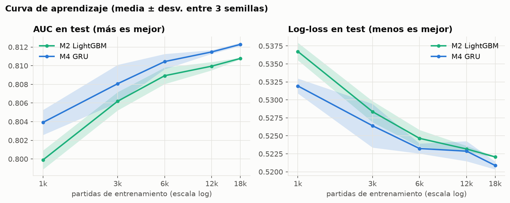

# B7 · TCN, búsqueda del MLP (N1) y curva de aprendizaje (E2)

*7–8 nov 2026. Se reproduce con:*
```
python src/hp_search.py --config configs/mlp_base.yaml --grid configs/grid_mlp.yaml --prefix mlp_hp   # 3 min
python src/hp_search.py --config configs/tcn_base.yaml --grid configs/grid_tcn.yaml --prefix tcn_hp   # 5 min
python src/learning_curve.py --set model.hidden=128 model.layers=2 model.dropout=0.1 train.lr=0.0003  # M2 + M4, ~4 min
python src/evaluate.py --run results/runs/m2_lgbm results/runs/mlp_hp__h64_l2_d0.3_lr0.001 results/runs/tcn_hp__h64_l3_d0.3_lr0.001 --name M2 M3_hp M5_hp
```

**Tiempos reales (RTX 4060):** una corrida de MLP tarda 5–20 s y una de TCN 10–40 s. Las búsquedas de 16 configuraciones duran **3–5 min**, no horas, así que no hace falta esperar a la noche para correrlas.

## M5 · TCN causal (`src/models/tcn.py`)

- Proyección lineal → `layers` bloques residuales con convoluciones causales dilatadas (dilatación 1, 2, 4, 8; kernel 3) → cabeza igual a la de la GRU.
- **Causal:** solo hay relleno a la izquierda. Los tests (`tests/test_b7.py`) verifican que cambiar el futuro no cambia el pasado, que el campo receptivo es exacto (`1 + 4·(2^layers − 1)`: 29 min con 3 bloques, 61 con 4) y que el relleno del final no afecta a los minutos válidos.
- Registrada en `src/models/__init__.py` como `tcn`, así `train.py` y `hp_search.py` la usan sin cambios. Config: `configs/tcn_base.yaml`; grid: `configs/grid_tcn.yaml`.

## Búsquedas de hiperparámetros (val, 1 semilla)

| Modelo | Mejor configuración | val_loss | val AUC | Rango de las 16 |
|---|---|---|---|---|
| M3 MLP | hidden 64, 2 capas, dropout 0.3, lr 1e-3 | 0.4930 | 0.8118 | 0.4930 – 0.4940 |
| M5 TCN | hidden 64, 3 bloques (29 min), dropout 0.3, lr 1e-3 | 0.4922 | 0.8121 | 0.4922 – 0.4934 |
| *M2 LightGBM (ref.)* | — | 0.4937 | 0.8113 | — |

- Los dos grids salen **planos**: la diferencia entre la mejor y la peor configuración es ~0.001 de log-loss. Los hiperparámetros casi no importan.
- En la TCN, 3 bloques (ve 29 min) le ganan levemente a 4 (61 min): ver la partida entera no aporta más que ver la última media hora.
- Tablas completas: `results/hp/mlp_hp.csv`, `results/hp/tcn_hp.csv`.

## Evaluación en test (preliminar, 1 semilla)

| Modelo | AUC | Log-loss | ECE | ΔAUC vs M2 (pareado) | ΔLog-loss vs M2 |
|---|---|---|---|---|---|
| M2 LightGBM | 0.811 | 0.522 | 0.019 | — | — |
| M3 MLP | 0.812 | 0.521 | 0.018 | +0.0012 [+0.0002, +0.0022] | −0.0014 [−0.0027, −0.0001] |
| M5 TCN | 0.813 | 0.520 | 0.021 | **+0.0021 [+0.0009, +0.0033]** | −0.0022 [−0.0040, −0.0005] |

La TCN es significativamente mejor que M2, pero por muy poco, y la ganancia está en los minutos 10–30 (`results/b5_comparacion_vs_M2.csv`). **Ver la historia aporta poco en AUC.** Eso hace más importante comparar los modelos por **valor** (B10/B12) y por suavidad de la curva (E6), no solo por AUC.

## E2 · Curva de aprendizaje (M2 y M4, 3 semillas)

```
python src/learning_curve.py --set model.hidden=128 model.layers=2 model.dropout=0.1 train.lr=0.0003   # ~4 min
```
M4 usa la mejor config de la GRU de N1 (`results/b6_resumen.md`). En cada tamaño y semilla, los dos modelos ven exactamente las mismas partidas.

| Partidas de train | M2 AUC test | M4 AUC test | M2 log-loss | M4 log-loss | Entrenar M2 / M4 |
|---|---|---|---|---|---|
| 1,000 | 0.7999 ± 0.0010 | **0.8039 ± 0.0013** | 0.5367 | **0.5319** | 1 s / 4 s |
| 3,000 | 0.8062 ± 0.0010 | **0.8081 ± 0.0020** | 0.5284 | **0.5264** | 2 s / 6 s |
| 6,000 | 0.8089 ± 0.0009 | **0.8104 ± 0.0008** | 0.5247 | **0.5232** | 3 s / 11 s |
| 12,000 | 0.8100 ± 0.0004 | **0.8115 ± 0.0002** | 0.5232 | **0.5229** | 5 s / 16 s |
| 18,294 (todo) | 0.8108 ± 0.0001 | **0.8123 ± 0.0002** | 0.5221 | **0.5209** | 7 s / 21 s |



- **La GRU gana en todos los tamaños**, y gana más con pocos datos: +0.004 de AUC con 1k partidas, +0.0015 con todo train.
- **La GRU aprovecha mejor los datos:** con 6k partidas (0.8104) rinde casi lo mismo que LightGBM con las 18k (0.8108).
- **Rendimientos decrecientes en los dos:** de 12k a 18k, M2 gana +0.0008 y M4 +0.0008. **Conseguir más partidas casi no mejoraría ningún modelo**; para mejorar habría que cambiar la información de entrada (features, campeones/M6), no la cantidad.
- **Costo:** con todo train, la GRU tarda 21 s de GPU (~USD 0.003 a USD 0.5/h). El costo de cómputo no es un factor para elegir modelo.
