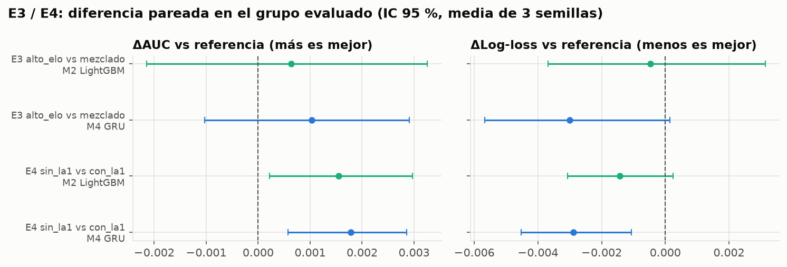

# B9 · E3 y E4: ¿el modelo generaliza a otros jugadores y regiones?

*8 nov 2026. Se reproduce con `python src/experiments_e3e4.py` (~5 min, 24 corridas: E3 + E4 × M2 + M4 × 2 condiciones × 3 semillas).*

## Diseño (comparación justa)

| | E3 · alto elo vs mezclado | E4 · región no vista |
|---|---|---|
| Pregunta | ¿Sirve entrenar con alto elo para jugadores promedio? | ¿Se puede lanzar en una región nueva sin reentrenar? |
| Condición | train **solo DIAMOND + MASTER** | train **sin LA1** (NA, EUW, KR) |
| Referencia | la misma cantidad al azar de **todos los tiers** | la misma cantidad al azar de **todas las regiones** (incluye LA1) |
| Partidas de train (cada condición) | 6,171 | 13,830 |
| Se evalúa en | test SILVER + GOLD (1,344 partidas) | test LA1 (1,008 partidas) |

- **Mismo tamaño de train** en las dos condiciones (guía, sección 4).
- **El grupo evaluado se quitó de val en las dos condiciones.** Val elige la época (early stopping) y la temperatura; si incluyera Silver/Gold (E3) o LA1 (E4), el modelo los habría "visto" al elegirse. El test no se tocó.
- M2 (LightGBM) y M4 (GRU, mejor config de N1), 3 semillas cada uno (la semilla cambia la submuestra y la inicialización).
- La diferencia se calcula con **bootstrap pareado** sobre las partidas evaluadas, promediando la diferencia de las 3 semillas en cada réplica.

## Resultados (en el grupo evaluado; media ± sd de 3 semillas)

| Exp. | Modelo | Condición | AUC | Log-loss | ΔAUC vs referencia | ΔLog-loss vs referencia |
|---|---|---|---|---|---|---|
| E3 | M2 | alto elo | 0.8069 ± 0.0006 | 0.5277 | +0.0006 [−0.0021, +0.0033] | −0.0005 [−0.0037, +0.0031] |
| E3 | M2 | mezclado (ref.) | 0.8062 ± 0.0014 | 0.5281 | — | — |
| E3 | M4 | alto elo | 0.8089 ± 0.0004 | 0.5260 | +0.0010 [−0.0010, +0.0029] | −0.0030 [−0.0057, +0.0001] |
| E3 | M4 | mezclado (ref.) | 0.8078 ± 0.0020 | 0.5290 | — | — |
| E4 | M2 | sin LA1 | 0.7999 ± 0.0003 | 0.5370 | +0.0015 [+0.0002, +0.0030] | −0.0014 [−0.0031, +0.0003] |
| E4 | M2 | con LA1 (ref.) | 0.7983 ± 0.0008 | 0.5385 | — | — |
| E4 | M4 | sin LA1 | 0.8004 ± 0.0011 | 0.5362 | +0.0018 [+0.0006, +0.0029] | −0.0029 [−0.0045, −0.0011] |
| E4 | M4 | con LA1 (ref.) | 0.7986 ± 0.0011 | 0.5391 | — | — |

Por corrida: `results/b9_e3e4_corridas.csv` (incluye las métricas en el resto del test). Resumen: `results/b9_e3e4.csv`.

## Qué significa

1. **E3: entrenar solo con alto elo NO perjudica a los jugadores promedio.** En Silver + Gold, el modelo entrenado con Diamond + Master rinde igual que uno entrenado con todos los tiers (Δ dentro del ruido, IC cruza 0). Lo que decide una partida (oro, objetivos, peleas) pesa igual en todos los elos.
2. **E4: el modelo se puede usar en una región nueva sin reentrenar.** Entrenar sin LA1 no empeora las predicciones en LA1; incluso sale levemente mejor (+0.002 de AUC con la GRU, significativo pero mínimo). No hace falta conseguir datos de cada región para lanzarlo en ella.
3. **Pero LA1 es más difícil de predecir con cualquier modelo.** Con el modelo entrenado con todo train, el AUC en test es LA1 0.800 · NA 0.805 · EUW 0.822 · KR 0.823 (GRU; M2 da lo mismo). La diferencia es de la región, no de con qué se entrenó: agregar partidas de LA1 al train no la cierra. Hipótesis para explorar en E5 (B12): más remontadas o partidas más caóticas en LA1/NA. Por tier no hay patrón de elo: Gold 0.799 es el más bajo y Silver 0.823 el más alto.
4. **Consecuencia para el negocio (viabilidad):** un solo modelo global sirve para todos los tiers y regiones. No hace falta un modelo por región ni por elo, lo que simplifica el despliegue y el mantenimiento. Para la sección 4.7 (sesgos): el modelo es ~0.02 de AUC peor en LA1 y NA que en EUW/KR; hay que reportarlo y ver en B12 si eso se traduce en menos valor para coaches de esas regiones.

**Limitaciones:** 3 semillas; un solo split temporal; LA1 es la única región probada como "no vista" (las demás combinaciones quedan como trabajo futuro).
